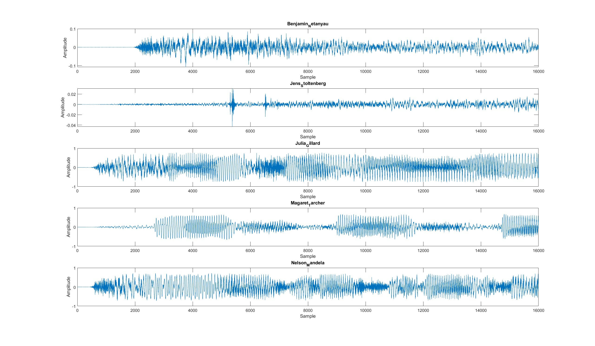
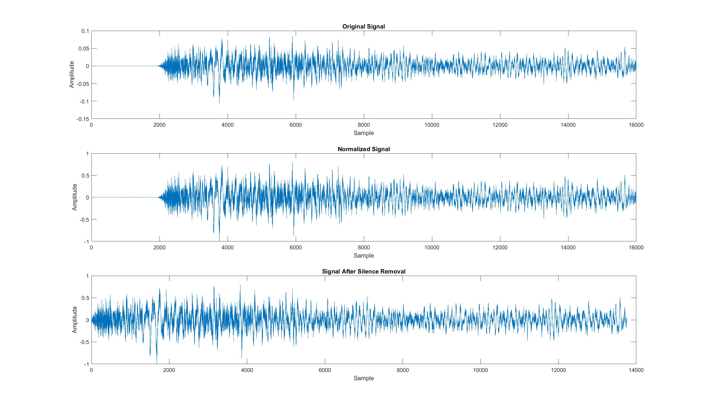
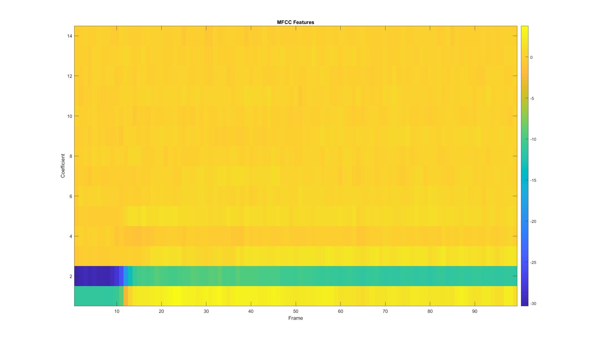
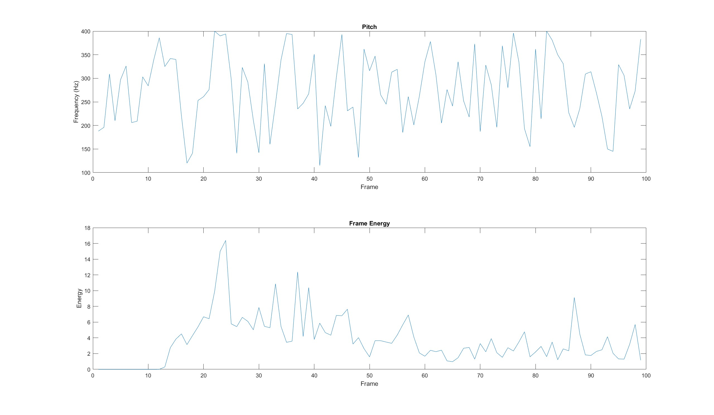
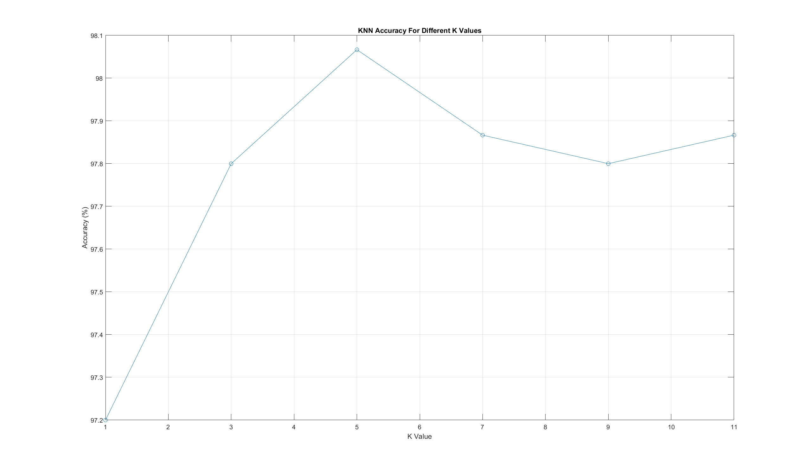
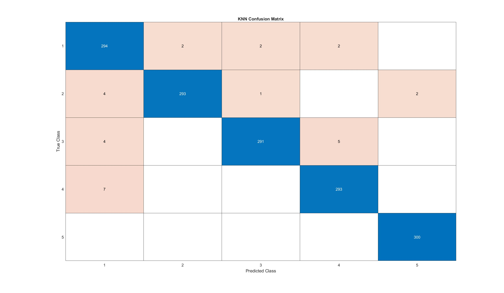
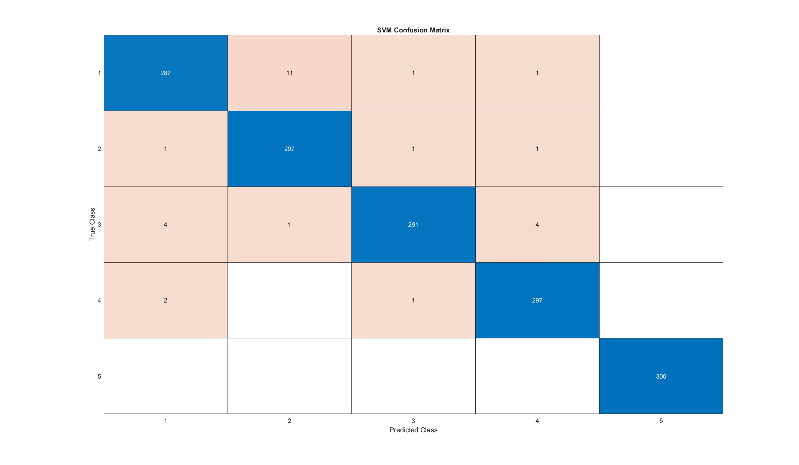
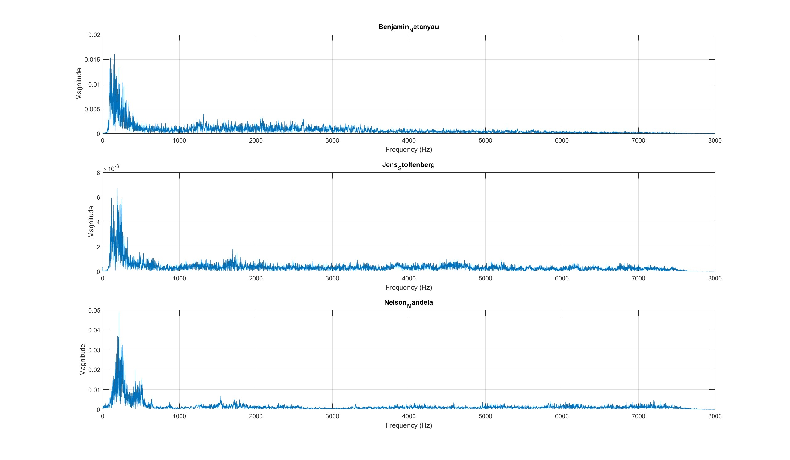
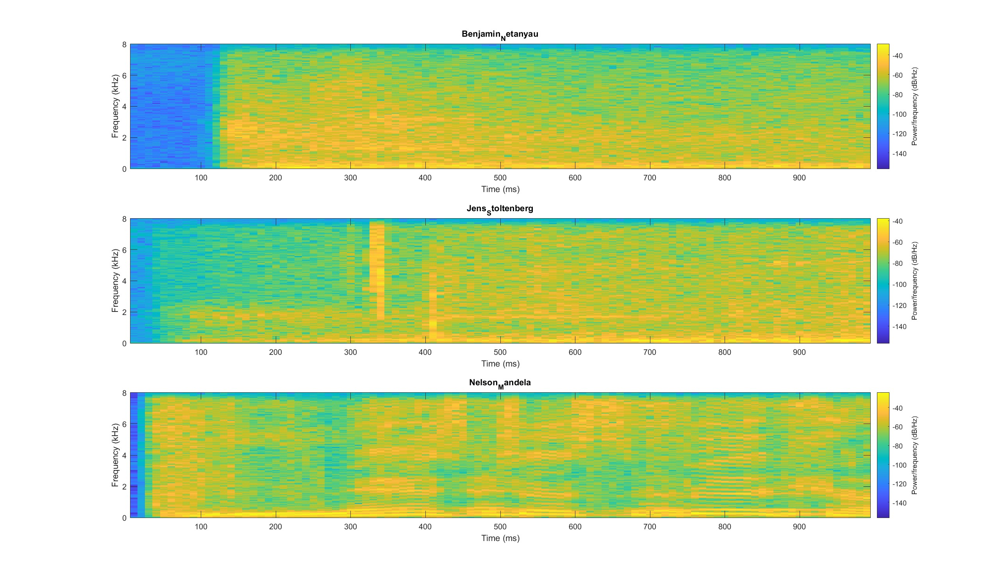

# Speaker Recognition

> Note: This is one sample of the projects I did in the Digital Signal Processing Lab. The other lab projects are not included in this repository.

A project for the Digital Signal Processing Lab (Spring 2026). The goal is to recognize who is speaking from a one-second speech clip. Written in MATLAB.

## Data

The [Speaker Recognition Dataset](https://www.kaggle.com/datasets/kongaevans/speaker-recognition-dataset) from Kaggle. It has speeches of five leaders. The audio is 16 kHz PCM. The author of the dataset cut each long speech into one-second clips. The speeches come from American Rhetoric.

- 7501 clips: 1500 for each speaker and 1501 for Julia Gillard
- I did not use the `_background_noise_` and `other` folders
- Folder names are the same as in the dataset (including its spelling mistakes)
- The data is not included in this repository. See `data/README.md`.

In the confusion matrices the classes are numbered in the order of the folder names:

| Class | Speaker |
|-------|---------|
| 1 | Benjamin_Netanyau |
| 2 | Jens_Stoltenberg |
| 3 | Julia_Gillard |
| 4 | Magaret_Tarcher |
| 5 | Nelson_Mandela |

## What I did

**1. Dataset check and preprocessing**
- Counted the clips and plotted one clip of each speaker
- Normalized the amplitude (divided by the peak value)
- Removed silence with an energy threshold (20 ms frames, 10 ms hop, threshold at 10% of the maximum frame energy). I only showed this on one clip (1 s became 0.86 s). It is not part of the feature extraction.

**2. Feature extraction** (one vector of 31 features for each clip)
- Frames of 20 ms with a Hamming window and 10 ms overlap, so 99 frames for each clip
- MFCC: 14 coefficients for each frame (MATLAB default, 13 coefficients plus log energy). I used the mean and the standard deviation of each one, so 28 features.
- Mean frame energy
- Mean zero crossing rate (ZCR)
- Mean pitch (SRH method, range 50 to 400 Hz)

**3. Classification**
- Z-score normalization of the features
- Stratified split: 6001 clips for training and 1500 for testing
- KNN with k = 1, 3, 5, 7, 9, 11
- Linear SVM with one-vs-one coding for 5 classes (`fitcecoc`)
- Metrics: accuracy, precision, recall and F1 (macro average), and confusion matrices

**4. Frequency analysis**
- FFT magnitude spectrum and spectrogram for three speakers (Netanyau, Stoltenberg, Mandela)

## Results

KNN accuracy for different k:

| k | 1 | 3 | 5 | 7 | 9 | 11 |
|---|---|---|---|---|---|---|
| Accuracy (%) | 97.20 | 97.80 | 98.07 | 97.87 | 97.80 | 97.87 |

| Model | Accuracy |
|-------|----------|
| KNN (k = 5) | 98.07% |
| Linear SVM | 98.13% |

SVM metrics: precision 98.15%, recall 98.13%, F1 98.13%.

- KNN and SVM are practically equal. SVM got 1 more clip right out of 1500.
- Nelson Mandela was recognized perfectly by both models.
- The most common error of the SVM was Netanyau recognized as Stoltenberg (11 clips).
- The spectra and spectrograms of the three speakers look different (energy distribution, harmonics, noise level).

## Figures











## Requirements

MATLAB (R20xx) with these toolboxes:

- Audio Toolbox (`mfcc`, `pitch`)
- Signal Processing Toolbox (`buffer`, `hamming`, `spectrogram`)
- Statistics and Machine Learning Toolbox (`cvpartition`, `fitcknn`, `fitcecoc`, `confusionchart`)

## How to run

Put the dataset in `data/` (see `data/README.md`), set MATLAB's current folder to this project folder and run:

```
addpath('src')
speaker_recognition
```

Feature extraction for all clips takes several minutes.

## Limitations

- I used one 80/20 split, and I chose k by looking at the test accuracy. The code also creates a 5-fold partition, but I did not use it. So the accuracy is a bit optimistic.
- The clips of each speaker come from one long recording and were split randomly between train and test. So training and test clips share the same microphone, room and noise, and the model may partly learn the recording conditions. On a different speech the accuracy would probably be lower.
- The pitch estimate is noisy. A 20 ms window is short for low voices, and the frame values jump between about 120 and 400 Hz.
- I normalized the features before splitting the data.
- I did not check which features are the most useful.

## Report

The full project report is also available in Persian. Email me at [MatNemati@gmail.com](mailto:MatNemati@gmail.com) if you would like to receive it.
